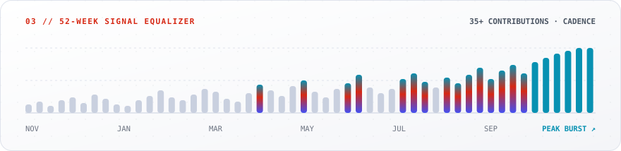
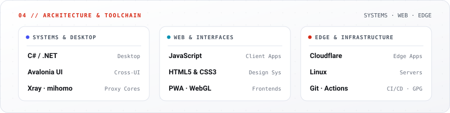

<a href="https://zekky.pages.dev">
  <picture>
    <source media="(prefers-color-scheme: dark)" srcset="assets/svg/hero-dark.svg" />
    
  </picture>
</a>

 

  <a href="https://zekky.pages.dev">
    <picture>
      <source media="(prefers-color-scheme: dark)" srcset="assets/svg/cta-portfolio-dark.svg" />
      
    </picture>
  </a>&nbsp;
  <a href="https://github.com/BlackkCore/Glide/releases/latest">
    <picture>
      <source media="(prefers-color-scheme: dark)" srcset="assets/svg/cta-glide-dark.svg" />
      
    </picture>
  </a>&nbsp;
  <a href="https://blackkcore.github.io/Trace/">
    <picture>
      <source media="(prefers-color-scheme: dark)" srcset="assets/svg/cta-trace-dark.svg" />
      
    </picture>
  </a>&nbsp;
  <a href="https://t.me/zekk4">
    <picture>
      <source media="(prefers-color-scheme: dark)" srcset="assets/svg/cta-telegram-dark.svg" />
      
    </picture>
  </a>

<picture>
  <source media="(prefers-color-scheme: dark)" srcset="assets/svg/telemetry-dark.svg" />
  
</picture>

  

  <a href="https://github.com/BlackkCore/Glide">
    <picture>
      <source media="(prefers-color-scheme: dark)" srcset="assets/svg/project-glide-dark.svg" />
      
    </picture>
  </a>&nbsp;
  <a href="https://github.com/BlackkCore/Trace">
    <picture>
      <source media="(prefers-color-scheme: dark)" srcset="assets/svg/project-trace-dark.svg" />
      
    </picture>
  </a>

<a href="https://sinafitt.com">
  <picture>
    <source media="(prefers-color-scheme: dark)" srcset="assets/svg/project-sinafit-dark.svg" />
    
  </picture>
</a>

  

<picture>
  <source media="(prefers-color-scheme: dark)" srcset="assets/svg/activity-dark.svg" />
  
</picture>

  

<picture>
  <source media="(prefers-color-scheme: dark)" srcset="assets/svg/stack-dark.svg" />
  
</picture>

  

<a href="https://zekky.pages.dev">
  <picture>
    <source media="(prefers-color-scheme: dark)" srcset="assets/svg/footer-dark.svg" />
    
  </picture>
</a>

 

<strong>About Me &amp; Project Links</strong>

I'm a developer focused on building practical, modern software — from polished web applications to desktop tools and networking utilities.

- Clean, intuitive user interfaces
- Performance, reliability, and security
- Thoughtful software architecture
- Creating useful tools that solve real problems

**Links:**
- **Glide:** [Official Website](https://g1ide.pages.dev/) · [Repository](https://github.com/BlackkCore/Glide) · [Download](https://github.com/BlackkCore/Glide/releases/latest)
- **Trace:** [Live Demo](https://blackkcore.github.io/Trace/) · [Repository](https://github.com/BlackkCore/Trace)
- **SinaFit:** [Visit Website](https://sinafitt.com) · [Portfolio](https://zekky.pages.dev)
- **Contact:** [Portfolio](https://zekky.pages.dev) · [Telegram (@zekk4)](https://t.me/zekk4)

